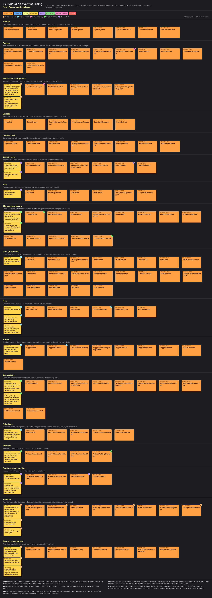

# Cloud event-storming study

This directory records an earlier design exercise, not the implementation plan
for the current branch. Its local SQLite ledger, JSON migration, writable content
store and disk-first rollout are superseded by the decision to keep cloud state
in memory across a cluster. They must not be reintroduced as deployment steps.

The study also discusses service feeds, operator pages, dataclips and a public
cloud helper package. Those features have been removed from this branch.

The [catalogue](catalogue.md), [aggregates](aggregates.md), [boards](boards/)
and [session contributions](session/) retain the historical evidence. They are
useful prompts for future design discussions, not accepted requirements. The
study used five simulated stakeholders over five rounds and produced 138 events,
17 contexts, 39 aggregates, 108 policies and 66 read models.

## Current implementation

Main's central session actor executes all sessions serially. It owns private
in-memory filesystem roots, history and pending observations. Commands start with
fresh lexical scope. Configuration is source checked before evaluation; ordinary
replies are direct, while explicit effects pass through Pass/Mock policy gates.

Workspace source edits and secrets are held by configuration actors. The registry
holds users, and artifact and routing actors hold their own state. Startup files
and imports are read-only inputs. No mutable cloud state is written to the host
filesystem, and deployment runs without a writable data volume.

Cluster replication and recovery are not implemented by this branch. A newly
started owner starts from its configured inputs; it does not restore local
snapshots. See [the state decision](../../../notes/cloud-memory-state.md) and
[process boundaries](../../../notes/cloud-process-boundaries.md).

## Questions for the cluster design

Before implementation, settle these contracts against the in-memory approach:

- Ownership and failover of the central serial executor, including how a stale
  owner is prevented from performing another external effect.
- Replication and acknowledgement boundaries for roots, history, configuration,
  users, secrets, artifacts and timers.
- Behavior during partitions and loss of all owners, including which operations
  may proceed and what recovery guarantees are promised.
- Duplicate delivery and retry rules for model calls and external posts. An
  in-memory replicated decision does not itself make a remote effect idempotent.
- Authorization for state transfer, secret handling and artifact access across
  nodes, and whether audit records require an independent external sink.
- Retention and collection of shared content blocks while roots remain private.

These are open design questions. The historical database outbox, local journal,
snapshot migration and disk-backed vault proposals are not prerequisites.
Network-secret policy remains an independent
[package](../../../eyg_packages/network_secrets/README.md); it adds no store.
