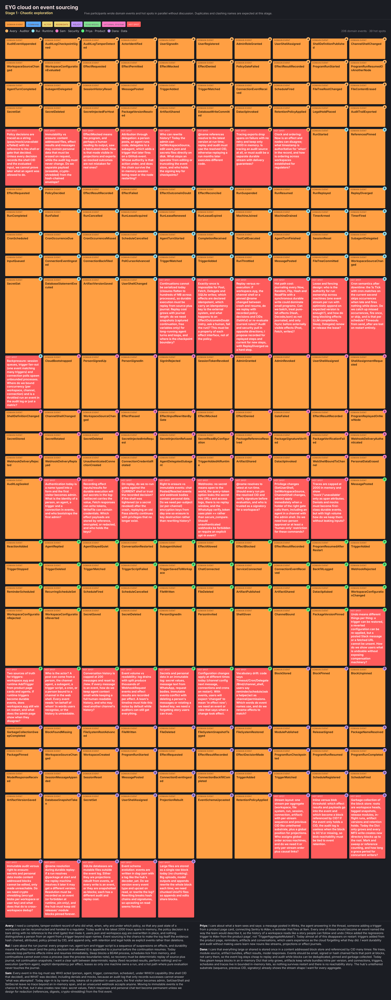
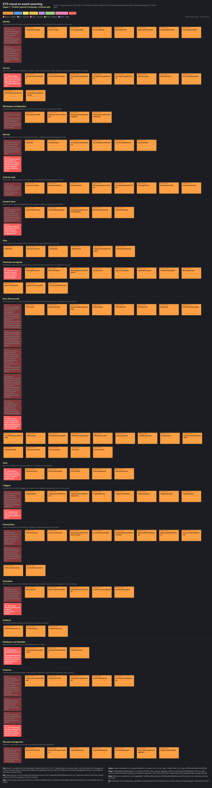

# Event sourcing the EYG cloud

The cloud project defines a cloud native computer. Software is used, or installed, by referring to its hash.
The file system is a shared immutable data structure. Programs only touch the world through effects,
so the result of every effect can be persisted before the program resumes, and a run appears durable
even when the machine running it crashes. The cloud has high audit requirements, so it is to be built on event sourcing:
every change is an immutable event and current state is a projection.

This page records an event storming session that designed that system, and the plan to build it.

- **Outcome:** 138 domain events in 17 bounded contexts, 39 aggregates, 108 policies and 66 read models,
  agreed by all five participants. Every hot spot raised was resolved.
- **The full catalogue:** [catalogue.md](./catalogue.md) lists every event with its command, actor, aggregate and policies,
  and [aggregates.md](./aggregates.md) every aggregate with its stream and invariants.
- **The record:** [session/](./session/) holds the brief, every round's instructions and every participant's contribution,
  [boards/](./boards/) the board at each stage and the final board as [HTML](./boards/final_board.html) and [JSON](./boards/final_board.json).

## The session

Five participants, each a simulated stakeholder with different priorities, worked in five rounds with a facilitator.
Each participant read the cloud's code and guides, and wrote to their own file in every round, so no one could overwrite another.

| Participant | Role | Priorities |
| --- | --- | --- |
| Avery | Auditor | A tamper evident record of who did what, when, why and under which policy. Retention, legal holds, exports. |
| Rui | Runtime engineer | Durable execution, replay, idempotency, leases across machines, schedules, a fast hot path. |
| Sam | Security engineer | Identity, policies as capabilities, secrets never in events, signed code, four eyes on privilege. |
| Priya | Product owner | What teams do and see in channels, language close to users, undo that people understand. |
| Dana | Data engineer | Content addressed storage, streams and projections, payloads as blocks, retention and garbage collection. |

| Round | Activity | Result |
| --- | --- | --- |
| 1. Chaotic exploration | Everyone wrote domain events and hot spots in parallel, without discussion | 206 events, 39 hot spots |
| Facilitation | Synonyms merged, events grouped into proposed contexts and ordered, hot spots consolidated | 106 events, 12 contexts, 20 hot spots |
| 2. Timeline and language | Each participant renamed, merged, split, added and removed events, and took a position on every hot spot | 126 events, 17 contexts, 19 hot spots resolved, 10 open |
| 3. Commands to read models | Each participant owned the contexts nearest their priorities and added commands, actors, aggregates, policies, read models and external systems | 138 events, 354 more stickies, every open hot spot proposed a resolution |
| 4. Agreement | Everyone reviewed every event | Dana agreed, four blocking objections, each with an exact fix |
| 5. Final agreement | The four fixes and four smaller ones as amendments | All five agreed |

### The board at each stage

| Stage | Board |
| --- | --- |
| 1. Chaotic exploration: a wall of events, coloured by author | [stage1.png](./boards/stage1.png) |
| Facilitator's draft timeline | [stage2a.png](./boards/stage2a.png) |
| 2. Timeline agreed in language, contexts split, hot spots resolved and open | [stage2.png](./boards/stage2.png) |
| 3. Commands, actors, aggregates, policies and read models | [stage3.png](./boards/stage3.png) |
| Final, agreed by everyone | [final_board.png](./boards/final_board.png), and the events only: [final_events.png](./boards/final_events.png) |

Stage 1 was the expected chaos: `EffectPermitted`, `EffectAllowed`, `EffectPassed` and `PolicyDecided` were four names for one fact,
and `RunResumed` had five synonyms.

In stage 2 the contexts split along the lines participants argued for. Sam separated authentication (identity) from grants (access),
Rui the run journal (runs) from coordination (fleet), Dana the content store from files and artifacts from databases,
Avery the evidence from records management, and Priya renamed conversations to channels because nobody says "session".

The final board is too tall to read on one screen. Here is its first part, with commands above each event and policies and read models below:

## Outcome

### Bounded contexts

| Context | Purpose | Aggregates | Events |
| --- | --- | --- | --- |
| Identity | Who people and API clients are and how they prove it | CloudInstallation, Person, SignInGuard, Credential | 8 |
| Access | Shell definitions, channel and person shells, admin, bindings, privilege proposals | ShellCatalog, ChannelAccess, PrivilegeChange, PersonGrants | 11 |
| Workspace configuration | Versions of `cloud.eyg` and `workspace.eyg` by source CID, and when a version applies | CloudConfiguration, WorkspaceConfiguration | 5 |
| Secrets | Names, versions and keyed fingerprints, values only in a vault | SecretVault, SecretEgress, LeakRegister | 6 |
| Code by hash | Signatories, signed releases, verification, pins | TrustStore, PackageRelease, ReleaseVerification, WorkspacePins | 8 |
| Content store | Blocks by CID, roots that keep them, garbage collection, integrity | ContentScope, Projection | 6 |
| Files | The workspace file system as a chain of roots | FileSystem | 6 |
| Channels and agents | Messages in and out, the agent's queue and turns | Channel, Conversation | 13 |
| Runs | One journal per run: basis, every effect decision and result, outcome | Run | 22 |
| Fleet | Machines, leases and admission, coordination rather than evidence | Machine, RunLease, Admission | 6 |
| Triggers | Configured and runtime triggers per channel | ChannelTriggers | 9 |
| Connections | Chats and services and every delivery they make | Connection, DeliveryInbox | 10 |
| Schedules | Reminders and recurring schedules that message a conversation | ScheduleBook | 5 |
| Artifacts | Versioned bundles owned by a channel | Artifact | 4 |
| Databases and dataclips | Named SQLite databases and the dataclips that read them | Database, Dataclip | 4 |
| Evidence | The hash chained ledger, checkpoints, verification, export, upcasters | CheckpointChain, AuditExport, UpcasterRegistry | 8 |
| Records management | Retention, legal holds and erasure | RetentionSchedule, LegalHold, DataSubject | 7 |

### The event envelope

Every event carries the same envelope, agreed through hot spots H7, H13, A2, N2 and N3:

| Field | |
| --- | --- |
| `id`, `type`, `schema` | The event's id, its type and schema version. Old versions are upcast on read, never rewritten. |
| `stream`, `version` | The aggregate's stream and its position in it. Appends are conditional on the expected version. |
| `previous` | The hash of the previous event in the same stream. Every stream is a hash chain. |
| `global_position` | Assigned at commit. Checkpoints fix every stream head at its global position, so the order across streams cannot be rearranged. |
| `committed_at` | The ledger's commit time is the authoritative "when". The `Now` effect's result is a recorded value, not a clock. |
| `actor` | `{kind: person, agent, trigger, schedule, connection or system, id}`. |
| `on_behalf_of` | The chain of delegation, ending in a person or a configuration version: "the regressions trigger in #dev, added by Bob". |
| `shell` | The CID of the shell, the policy, the actor held. |
| `causation`, `correlation` | The event or command that caused this one, and the run or request it belongs to. |
| `machine`, `epoch` | For run events, the machine and lease epoch that appended it. A stream refuses an append with a stale epoch. |
| payload | Inline up to 4 KiB, otherwise a block referenced by CID. Personal data is encrypted with a subject key. |
| digests | Every digest that is not a content CID is a keyed HMAC, with the subject key for personal data and the workspace key otherwise, so shredding the key makes them meaningless. |

### How a run becomes durable

A run is any execution of an EYG program: a message someone posts as code, an agent's turn, a trigger's script, a scheduled occurrence,
a dataclip or a subagent. Its id is derived from its cause, so a delivery that arrives twice cannot start two runs:
a turn is conversation plus turn number, a trigger run is the trigger definition's CID plus the event id,
a schedule run is the schedule plus the occurrence's due time, a child run is its parent run plus step.

1. `RunStarted`, then `RunBasisPinned`: the source CID, the map from every `@name` reference to the release CID it resolved to,
   the interpreter version and the shell CID. Replay never asks the hub again.
2. For each effect, the gate decides and the decision is appended **before** anything is performed:
   `EffectPassed` (with `EffectInputRewrittenByGate` when the gate changed the request), `EffectMocked`, `EffectDenied` or `GateFailed`.
   Because gates are pure, the request and its decision are one fact. The append, at the stream's expected version,
   is both the marker that an effect may be in flight and the fence against a second machine.
3. The effect is performed according to its delivery class (below). Secret values in results are replaced before anything is stored
   and before the program resumes, so the program, the journal and every block see the same value.
4. `EffectResultRecorded` is appended, then the program resumes. `Now`, `Random`, `Flip` and lazily resolved references are buffered
   and written as one `LocalEffectResultsRecorded` before the next effect the world can see, so they cost no extra write.
5. A crash leaves the run without a terminal event. When its lease expires another machine acquires it with a higher epoch,
   appends `RunResumed` and runs the program again from its pinned source, feeding it the recorded results.
   Recorded decisions are reused, because those effects happened. Every new step is decided by the shell in force now,
   and a changed shell is recorded as `RunResumedUnderNewShell`. A replay that asks for a different effect than the journal records is `ReplayDiverged`.
6. `RunCompleted`, `RunFailed` or `RunCancelled`.

EYG closures cannot be serialised today (see [process boundaries](../../../notes/cloud-process-boundaries.md)), so durability is replay, not snapshots.
Runs are already short: a turn is at most 16 completions, and each trigger match and schedule occurrence is its own run.
A run's journal is capped, and checkpoints at suspension points come later, once closures capture only their free variables.

| Delivery class | Effects | After a crash |
| --- | --- | --- |
| pure | `DecodeJSON`, `Hash` | Not journaled, evaluated again |
| local | `Now`, `Random`, `Flip` | Journaled in batches, replayed |
| internal | files, triggers, schedules, artifacts, `SQLite`, `Dataclip`, `Delegate`, the configuration API | The target aggregate receives a command keyed by run and step, so a repeat returns the original result: exactly once without transactions across streams |
| idempotent | model completions, `Fetch` with an idempotency key | Retried with the same key, `EffectRetryScheduled` |
| keyed | `Post` | The platform deduplicates by the message's client id, or the post is reconciled against the platform |
| unsafe | any other `Fetch` | Never retried automatically: `EffectOutcomeInDoubt`, reconciled from evidence or by a person (`EffectReconciled`) |

### Decisions

Each line is a hot spot raised during the session and the resolution everyone agreed.

| | Decision |
| --- | --- |
| H1 | Decisions are separate events, `EffectPassed`, `EffectMocked`, `EffectDenied`, `GateFailed`, each with the shell CID. `EffectRequested` folds into them. A gate's rewrite is its own event with digests only. |
| H2 | Replay reuses recorded decisions, new steps are decided by the current shell. |
| H3 | Every effect declares a delivery class, unsafe effects are never retried automatically. |
| H4 | Everything that shapes behaviour is journaled. `ReadFile` records content CIDs, not bytes. |
| H5 | `EffectMocked` is its own event. Projections of the world only consume real results, replay feeds the mock. |
| H6 | Personal data stays out of envelopes. Payloads are encrypted blocks, erasure shreds the key. |
| H7, N2 | A stream per aggregate with conditional appends, every stream hash chained, a global position at commit, checkpoints sign a Merkle root over the stream heads. |
| H8 | Events are never rewritten. Pure upcasters by CID are applied on read, registering one is an event. |
| H9 | Traces are a projection of the journal and decisions, never the record. |
| H10, N4 | Effects record a secret's name and version, never its value or a plain hash of it. Replay reads the version from the vault. |
| H11 | `RunBasisPinned` stores how every `@name` resolved, as one block. |
| H12 | Payloads up to 4 KiB inline, larger ones as blocks, chunked above 256 KiB. A block is written before the event that refers to it. |
| H13 | The mandatory envelope above. |
| H14 | `CloudBootstrapped` by a one time code the server prints, then invitation only. Sign in records the verified provider and subject. |
| H15 | Configured and runtime triggers are both durable. Configuration wins a name clash and the runtime trigger is `TriggerShadowedByConfiguration`. |
| H16 | A webhook without a secret is an explicit, attributed opt in, flagged in every view. Tokens in URLs are deprecated. |
| H17 | Every delivery is stored as a block, high volume sources in batches, matched deliveries are kept as long as their run. |
| H19 | Each schedule declares a catch up policy, by default one late occurrence, the rest recorded as `CronOccurrenceMissed`. |
| H20 | A revert is a new `WorkspaceSourceChanged` that restores an earlier source CID. Effects already performed stay facts, and the UI lists what a revert cannot undo. |
| O1 | A database's event stream is the record and the SQLite file a working copy. Each statement commits with a (run, step) row in a cloud owned outbox table, non deterministic SQL is rejected. |
| O2 | A dedicated ledger key in an HSM or keyring, never in the data directory. Checkpoints are anchored to the hub and a public transparency log, and checked by an independent verifier. |
| O3, A3, A4 | A second person approves anything that widens privilege or exposure, or destroys or reinterprets evidence. The shells catalogue in `cloud.eyg` is pre-approved, so assigning one of its shells other than `admin` needs no second person. Agents, triggers and schedules propose, never approve. A sole admin may self approve after 24 hours, flagged in every export. |
| O4 | Blocks deduplicate within a workspace only, except public hub modules. Holds and erasure act on roots and keys, never single blocks. |
| O5 | No checkpoints in the first phase, a cap on a run's journal. Checkpoints at suspension points later. |
| O6 | Admission slots per workspace and channel, a separate limit on model calls, suspended runs hold no slot, a child borrows its parent's slot, delegation depth is capped at 4. |
| O7 | Secret placeholders become random handles per secret version issued by the vault. Secrets are only injected where a program names them. |
| O8 | Members read their channel's history. Binding grants a channel's powers, not its history. Anyone else reads it through a recorded `ChannelHistoryOpened`. |
| O9 | A reminder belongs to its conversation and survives `/new`. Erasing the conversation cancels it. |
| O10 | Submitting an identical trigger card is a no op. A changed card is an explicit `TriggerReplaced` with both definition CIDs. |
| A1 | Secret values found in results are redacted before any block is stored and before the program resumes. |
| A2 | Every digest that is not a content CID is a keyed HMAC. |
| N1 | `cloud.eyg` versions are `CloudSourceChanged`, by `SetCloudSource`, with compare and set like workspaces. |
| N3 | Every run event names its machine and lease epoch. `MachineJoined` and `MachineDrained` are evidence. |

Removed during the session, with the reason: `AgentReplied` (a `MessagePosted` by an agent), `ModelResponseReceived` (a recorded result of the model effect),
`EffectRequested` (folded into the decisions), `RunLeaseRenewed` (heartbeats are not evidence), `BlockStored` (putting a block is idempotent and proven by its CID),
`FileSystemRootAdvanced` (file events carry both roots), `SecretReadByConfiguration` (listed in `WorkspaceConfigurationApplied`),
`WorkspaceConfigurationReverted` (a revert is a source change), `ShellAssignmentRequested` (replaced by privilege proposals),
`PackageNameResolved` (in `RunBasisPinned`), `PersonalDataErased` (split into request, refusal and key shredding)
and `EventSchemaUpcasted` (upcasting is on read).

### Refinements noted at sign off

These were raised as non-blocking notes in the last round and are part of the design:

- A checkpoint's Merkle leaves are `(stream, head hash, head global position)`. (Avery)
- A run stream enforces lease epochs itself: `RunResumed` carries the new epoch and the stream refuses lower epochs, so the hot path never asks the lease store. (Rui)
- When a subject key has been shredded, replay cannot compute the keyed digests, so the run is cancelled with reason erased rather than reaching `ReplayDiverged`. (Rui)
- A catalogue shell whose gates include configuration API, secret or bind effects counts as admin equivalent and still needs a second person. (Sam)
- A leaked secret is redacted to a marker that cannot be injected, `eyg-redacted:<name>@<version>`, rather than to its handle, so handles never leave the vault. (Sam)

## Implementation plan

### What exists today

Almost all of the cloud's state is in memory and lost on restart. The plan replaces each piece in turn, behind the actor APIs that already exist.

| State today | Where | Becomes |
| --- | --- | --- |
| People and their shells | `users.json`, [`cloud/users`](../../../packages/cloud/src/cloud/users.gleam), [`cloud/registry`](../../../packages/cloud/src/cloud/registry.gleam) | Person, Credential, PersonGrants streams |
| Shells | evaluated from `cloud.eyg` by [`cloud/instance`](../../../packages/cloud/src/cloud/instance.gleam) | CloudConfiguration and ShellCatalog |
| Workspace configuration | `workspace.eyg` written by `SetWorkspaceSource` in [`cloud/api`](../../../packages/cloud/src/cloud/api.gleam) | WorkspaceConfiguration, the file becomes a projection |
| Secrets | `secrets.json` in the data directory, [`cloud/secrets`](../../../packages/cloud/src/cloud/secrets.gleam) | SecretVault: values in a vault, facts in events |
| Triggers, schedules, connection logs (500 events), channel sessions | dictionaries in the workspace actor, [`cloud/workspace`](../../../packages/cloud/src/cloud/workspace.gleam) | ChannelTriggers, ScheduleBook, DeliveryInbox, Conversation streams |
| Agent history (200 messages) | the session actor, [`cloud/session`](../../../packages/cloud/src/cloud/session.gleam) | a projection of the Conversation stream |
| Effects | performed and forgotten in `loop` in [`cloud/beam/execute`](../../../packages/cloud/src/cloud/beam/execute.gleam) | the Run journal |
| Files | an in-memory block dictionary under MFS, [`cloud/files`](../../../packages/cloud/src/cloud/files.gleam) | FileSystem stream over a persistent ContentScope |
| Artifacts | in memory, [`cloud/artifacts`](../../../packages/cloud/src/cloud/artifacts.gleam) | Artifact streams of UnixFS roots |
| Databases | SQLite files, [`cloud/database`](../../../packages/cloud/src/cloud/database.gleam) | working copies with an outbox, Database streams |
| Traces | the latest 2000 spans in memory, [`cloud/tracing`](../../../packages/cloud/src/cloud/tracing.gleam) | a projection of the journal |

Much of what the plan needs is already in the repository:

- `sqlight` is a dependency of the cloud since dataclips, so the first event store is SQLite in the data directory.
- [`untethered`](../../../packages/untethered/) defines the hub's signed chains: an entry has a sequence, the CID of the previous entry and a key.
  Stream hash chains and anchoring checkpoints to the hub use its format.
- [`glasshouse`](../../../packages/glasshouse/) defines the effect journal entry, how an effect was answered (performed, gated, altered, mocked),
  a recorder that stores large values as DAG-JSON blocks above a threshold and redacts known secrets, a content addressed store with
  reachability, and `rerun`, which runs a recorded program against its replies. It is pure Gleam and compiles for the cloud's Erlang target.
- Loam's [`record`](../../../packages/loam/src/loam/record.gleam) already runs pinned programs and records every effect, the cloud's runs follow the same shape.
- [`execute.loop`](../../../packages/cloud/src/cloud/beam/execute.gleam) handles every effect in one place: `decide`, then `perform`, then `block.resume`.
  That is where the journal goes.

### Principles

- One context at a time. Each phase ships on its own, and the actor messages other modules use stay the same while their state moves into streams.
- Test every aggregate as given events, when a command, then events or an error. Test every invariant on the board.
- Migration is explicit. Existing `users.json`, `secrets.json` and data are imported once with events whose actor is `system` and whose causation is the migration.
- No new effects except where the board requires one (`UnshareArtifact`, the inverse of `ShareArtifact`), as [AGENTS.md](../../../AGENTS.md) asks.

### Phase 0: the ledger

New modules under `packages/cloud/src/cloud/ledger/`.

- `ledger/store`: an `events` table with `global_position` as an increasing primary key, `stream`, `version`, `type`, `schema`,
  the encoded envelope, an inline payload or a payload CID, `previous` and `hash`, unique on `(stream, version)`.
  `append(stream, expected_version, events)` runs in one transaction and fails on a version conflict.
  One writer process per data directory, so a single node needs no other coordination.
- `ledger/chain`: each event is encoded as an untethered entry (sequence, previous CID, key, content) in DAG-JSON and hashed to a CID.
  `verify(stream)` and `verify_all()` recompute every chain.
- `ledger/blocks`: a `blocks` table keyed by CID and scope, written with the glasshouse store and recorder: payloads above 4 KiB become blocks,
  blocks are written before the event that refers to them, and a `missing` check runs before every append.
- `ledger/keys`: workspace and subject keys, keyed HMAC digests with `gleam/crypto`, encryption of blocks per scope. Keys live in the data directory at first,
  moving to an OS keyring or HSM in phase 6.
- `ledger/projection`: projections subscribe from a stored global position, can be rebuilt from zero, and record `ProjectionRebuilt`.
- `ledger/upcast`: upcasters registered per type and schema version, applied on read.
- A `gleam run -m cloud/ledger -- verify <data directory>` command.

Tests: conflicting appends, chain verification, a hand edited row detected by `verify`, an event refused when its block is missing, keyed digests changing with the key.

### Phase 1: identity, access, configuration and secrets

- Replace `users.json`: `CloudBootstrapped` with a one time code the server prints at first start replaces "the first visitor is admin" in the sign in route of
  [`cloud/server`](../../../packages/cloud/src/cloud/server.gleam). Invitations, sign in, credentials and deactivation become Person and Credential events.
- `cloud.eyg` versions become `CloudSourceChanged`, the shells catalogue is ShellCatalog.
  `SetUserShell` becomes `PersonShellAssigned`, a catalogue shell other than `admin` (and not admin equivalent) is applied at once, anything else is a `PrivilegeChangeProposed`.
  The admin page gets a list of proposals to approve or decline, and the `admin` and `configure` shells in [`shell.eyg`](../../../eyg_packages/cloud/shell.eyg) gain gates for the new operations.
- `SetWorkspaceSource` appends `WorkspaceSourceChanged` with the source as a block and a compare and set on the previous CID. The file on disk is kept as a projection so editors still work.
  `WorkspaceConfigurationApplied` is appended once per version, with the names and versions of the secrets it read.
- Secrets move from `secrets.json` to a vault table. Events carry the name, version and keyed fingerprint.
  The network secret placeholder in [`secrets.eyg`](../../../eyg_packages/cloud/secrets.eyg), today `eyg-secret-` plus an unsalted SHA-256 of the value, becomes a random handle per version,
  and the implicit `Bearer` header becomes a logged, deprecated opt in.

Done when a restart keeps people, shells, configuration history and secrets, and the admin page shows who changed what.

### Phase 2: the run journal

The core of durable execution.

- A `cloud/run` module with the Run aggregate, run ids derived from causes, and `RunStarted` and `RunBasisPinned`.
  References found in the source are resolved before the run starts. References resolved lazily through `UndefinedReference` in `execute.loop` are buffered and recorded.
- Each effect label gets a delivery class next to the policy `rules` in `execute.gleam`.
- `execute.loop` appends the decision after `decide`, performs according to the class, redacts, and appends the result before `block.resume`.
  The journal entry and its encoding reuse `glasshouse/journal` and the recorder.
- Replay re-runs the program from its pinned source and answers each effect from the journal, as `glasshouse/rerun` does.
  On start, the cloud scans for runs with no terminal event and resumes them.
- An agent's turn becomes a run. Each model completion is a recorded effect result, and the agent's history in `cloud/session` becomes a projection of the Conversation stream,
  so a crash mid-turn resumes the turn without calling the model or posting again.
- `Sleep` becomes `RunSuspended` with a wake time, on a durable wake queue shared with schedules.
- Leases with epochs, one machine at this phase, so a lease is a row the single node owns.
- `cloud/tracing` builds its spans from journal events, OTLP export is unchanged.

Done when the BEAM is killed in the middle of a run that has posted to the example chat, and after a restart the run completes without posting twice.

### Phase 3: channels, triggers, schedules and connections

- The workspace actor's dictionaries become projections, rebuilt from their streams when a workspace starts.
- Runtime triggers from `AddTrigger` are durable, with definition CIDs, `TriggerReplaced` and `TriggerShadowedByConfiguration`.
- Schedules move from the one second `Tick` to the durable wake queue, with catch up policies and `CronOccurrenceMissed`.
- Pollers in [`cloud/connections`](../../../packages/cloud/src/cloud/connections/) record `PollCursorAdvanced` instead of keeping seen sets in memory.
  Webhook and poll deliveries go to the DeliveryInbox as blocks, deduplicated by delivery id.
- Plugins report `ChannelNamed`, so renaming a channel cannot silently change its shell.
- The Activity read model per channel and workspace, and a History tab on the admin page built from events.

Done when a restart keeps triggers, reminders and connection cursors, and a webhook delivered twice runs its trigger once.

### Phase 4: content and files

- `cloud/files` keeps MFS but stores blocks in the persistent content scope, and the FileSystem stream records each change with its previous and new root.
- Roots are pinned by the file system head, retained journals, artifacts and legal holds. Garbage collection marks from live roots and sweeps the rest.
- Files above 256 KiB are chunked, and blocks are encrypted with the workspace scope key.

Done when files survive a restart and a sweep removes unreferenced blocks but keeps every pinned or held root.

### Phase 5: artifacts and databases

- Artifact bundles become UnixFS directory roots in `cloud/artifacts`, versions and editing shares are events,
  `ArtifactVisibilityChanged` decides who may view, and the new `UnshareArtifact` effect reverses `ShareArtifact`.
  Existing links stay public until changed, so nothing already shared breaks.
- `cloud/database` runs each statement in a transaction that also writes `(run, step, sequence)` to an outbox table in the SQLite file,
  then appends `DatabaseStatementExecuted`. On start, any outbox row without its event is appended. Non deterministic SQL functions are refused.
  Snapshots are blocks, and `DatabaseRestored` moves forward to an old state.

Done when a crash between a SQLite commit and its event leaves no gap after restart.

### Phase 6: evidence and records

- Checkpoints: a Merkle root over every stream head with its global position, signed by a ledger key held in an OS keyring or HSM,
  anchored to the hub as an untethered chain and to a timestamp authority.
- An independent verifier that reads an export, checks every chain against the anchored checkpoints and reports `AuditLogVerified`.
- Retention policies, legal holds and erasure with subject keys and crypto-shredding, each needing a second person where the board says so.
- Exports bundle events with the blocks they are entitled to, encrypted to the recipient.

Done when the verifier detects an edited row, and after an erasure the chain still verifies while the subject's payloads cannot be read.

### Phase 7: the fleet

- More than one machine needs conditional appends from every node, so the event store moves from SQLite to a shared database such as Postgres,
  behind the same `ledger/store` interface.
- Machines join with a key and the operator credential that admitted them, `MachineJoined` and `MachineDrained` are evidence.
- Leases with epochs across machines, admission slots per workspace and channel.

Done when one of two nodes is killed and its runs resume on the other.

### Order and size

| Phase | Depends on | Size |
| --- | --- | --- |
| 0. Ledger | | Medium |
| 1. Identity, access, configuration, secrets | 0 | Medium |
| 2. Run journal | 0, 1 for shell CIDs and secret versions | Large |
| 3. Channels, triggers, schedules, connections | 2 | Large |
| 4. Content and files | 0 | Medium |
| 5. Artifacts and databases | 2, 4 | Medium |
| 6. Evidence and records | 0, 4 | Large |
| 7. Fleet | 2, 3 | Large |

Phases 1 and 4 can run alongside each other after phase 0, and phase 6 can start once blocks are persistent.

### Risks

- **Replay cost.** Until closures can be serialised, a run is replayed from its start. Runs are short by design, and the journal cap makes long loops visible early.
- **One writer.** SQLite and a single writer process are enough for one node. The fleet needs the store behind `ledger/store` to change.
- **Key management on the BEAM.** Keyring and HSM access from Erlang needs work, the first phases keep keys in the data directory and say so.
- **Volume.** Log drains can send thousands of deliveries a minute. Batching them into blocks keeps the ledger small, but retention for deliveries has to be set per connection.
- **Latency.** Each externally visible effect adds one append before and one after. Local effects are batched, and internal effects write in the same append as their result.
